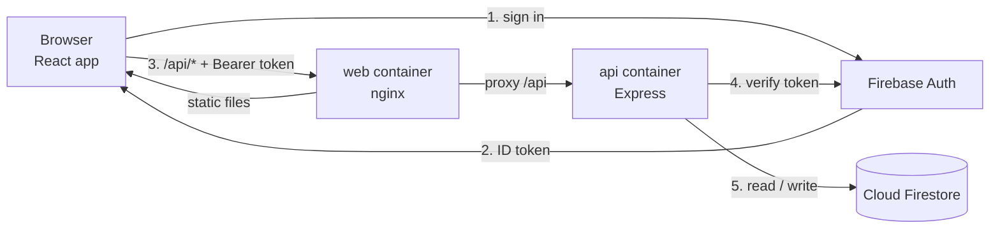

<a id="readme-top"></a>

<!-- PROJECT SHIELDS -->
[![CI][ci-shield]][ci-url]
[![Last commit][commit-shield]][commit-url]
[![Issues][issues-shield]][issues-url]

<!-- PROJECT LOGO -->
<br />
<div align="center">
  <h1 align="center">🌸 Workout Logger</h1>

  <p align="center">
    A full-stack web app for logging gym sessions and tracking volume and personal records.
    <br />
    React · Express · Firebase · Docker · GitHub Actions
    <br />
    <br />
    <a href="#getting-started"><strong>Get started »</strong></a>
    <br />
    <br />
    <a href="https://github.com/helgaszebenyi/workout-logger/issues/new?labels=bug">Report Bug</a>
    &middot;
    <a href="https://github.com/helgaszebenyi/workout-logger/issues/new?labels=enhancement">Request Feature</a>
  </p>
</div>

<!-- TABLE OF CONTENTS -->
<details>
  <summary>Table of Contents</summary>
  <ol>
    <li>
      <a href="#about-the-project">About The Project</a>
      <ul>
        <li><a href="#features">Features</a></li>
        <li><a href="#built-with">Built With</a></li>
      </ul>
    </li>
    <li><a href="#architecture">Architecture</a></li>
    <li>
      <a href="#getting-started">Getting Started</a>
      <ul>
        <li><a href="#prerequisites">Prerequisites</a></li>
        <li><a href="#installation">Installation</a></li>
      </ul>
    </li>
    <li><a href="#usage">Usage</a></li>
    <li><a href="#testing--ci">Testing &amp; CI</a></li>
    <li><a href="#roadmap">Roadmap</a></li>
    <li><a href="#contributing">Contributing</a></li>
    <li><a href="#contact">Contact</a></li>
    <li><a href="#acknowledgments">Acknowledgments</a></li>
  </ol>
</details>


<!-- ABOUT THE PROJECT -->
## About The Project

[![Workout Logger screenshot][product-screenshot]](#about-the-project)

Workout Logger lets you record your training sessions (exercises, sets, reps, weights and timed holds such as planks) and see your progress at a glance: total workouts, sets and volume, plus automatic personal records per exercise.

It's built the way a production service would be: a layered REST API with tests, a React frontend, Firebase for authentication and storage, both parts packaged as hardened Docker images, and a CI pipeline that tests every change and publishes the images to GitHub Container Registry.

### Features

- Email/password and Google sign-in (Firebase Authentication)
- Create, edit and delete workouts with any number of exercises and sets
- Rep-based sets (reps × kg, bodyweight when no weight is given) and timed sets (minutes:seconds)
- Overview: total workouts, workouts in the last 30 days, total sets and total volume
- Personal records per exercise, calculated automatically
- Workouts grouped by month
- Each user only ever sees their own data, enforced on the server

<p align="right">(<a href="#readme-top">back to top</a>)</p>

### Built With

* [![React][React-badge]][React-url]
* [![Vite][Vite-badge]][Vite-url]
* [![Node.js][Node-badge]][Node-url]
* [![Express][Express-badge]][Express-url]
* [![Firebase][Firebase-badge]][Firebase-url]
* [![Docker][Docker-badge]][Docker-url]
* [![Nginx][Nginx-badge]][Nginx-url]
* [![GitHub Actions][Actions-badge]][Actions-url]

<p align="right">(<a href="#readme-top">back to top</a>)</p>


<!-- ARCHITECTURE -->
## Architecture



1. The browser signs in with the Firebase JS SDK and receives a signed **ID token**.
2. Every API call sends that token as `Authorization: Bearer <token>`.
3. nginx serves the built React app and forwards `/api` to the API container, so the browser only ever talks to one address (no CORS needed).
4. The API verifies the token with the Firebase Admin SDK and takes the user id **only** from the verified token.
5. Workouts are stored under `users/{uid}/workouts/{id}`, so every query is limited to one user.

### API layers

```
routes/          HTTP only: read the request, call the service, send the response
  └─ services/   business logic: ownership, timestamps, statistics
       └─ repositories/   storage behind an abstract interface
            ├─ FirestoreWorkoutRepository   (production)
            └─ InMemoryWorkoutRepository    (tests)
models/          Workout / Exercise classes with their own validation
```

Dependencies are passed in from outside (`createApp({ workoutService, verifyToken, checkReady })`), so the whole HTTP layer is tested with an in-memory repository and a fake token checker, without a network connection or a Firebase project.

### Containers

| Image | Base | What it does |
|---|---|---|
| `workout-logger-api` | `node:22-alpine` | Runs the Express API as a non-root user, with a health check and graceful shutdown on `SIGTERM` |
| `workout-logger-web` | `node:22-alpine` → `nginx-unprivileged` | Builds the React app in a Node stage, then serves only the static files with nginx; Firebase settings are injected at start-up from environment variables |

Health endpoints: `GET /healthz` (liveness) and `GET /readyz` (readiness, checks Firestore), ready for Kubernetes probes.

<p align="right">(<a href="#readme-top">back to top</a>)</p>


<!-- GETTING STARTED -->
## Getting Started

### Prerequisites

* [Docker Desktop](https://www.docker.com/products/docker-desktop/) (includes Docker Compose)
* [Node.js 22](https://nodejs.org/) (only needed to run without Docker)
* A free [Firebase](https://console.firebase.google.com/) project (Spark plan is enough)

### Installation

1. **Set up Firebase**
   * *Authentication → Sign-in method:* enable **Email/Password** and **Google**
   * *Firestore Database:* create a database
   * *Project settings → General → Your apps:* add a **Web app** and copy its config values
   * *Project settings → Service accounts:* **Generate new private key**
2. **Clone the repo**
   ```sh
   git clone https://github.com/helgaszebenyi/workout-logger.git
   cd workout-logger
   ```
3. **Add your secrets** (both are git-ignored, never commit them)
   * Save the private key as `secrets/service-account.json`
   * Copy the example env file and fill in the web app values from step 1:
     ```sh
     cp .env.example .env
     ```
4. **Start the app**
   ```sh
   docker compose up --build
   ```
5. Open <http://localhost:8080>

#### Run without Docker (development)

```sh
# terminal 1: API on port 3000
cd api
cp .env.example .env      # fill in
npm install
npm run dev

# terminal 2: React dev server on port 5173 (proxies /api to port 3000)
cd web
cp public/config.example.js public/config.js   # fill in
npm install
npm run dev
```

<p align="right">(<a href="#readme-top">back to top</a>)</p>


<!-- USAGE -->
## Usage

1. Sign in with email/password or Google.
2. Click **+ New workout**, give it a title and a date, and add exercises.
   * For each exercise choose **Reps** (reps and kg; leave kg at 0 for bodyweight) or **Time** (minutes and seconds, e.g. a plank).
   * **+ Set** copies the previous set, since you usually repeat the same numbers.
3. Your overview, personal records and month groups update straight away.
4. Use **Edit** or **Delete** on any workout card.

### API reference

All `/api` endpoints require `Authorization: Bearer <Firebase ID token>`.

| Method | Path | Description |
|---|---|---|
| `GET` | `/api/workouts` | List your workouts, newest first |
| `POST` | `/api/workouts` | Create a workout |
| `GET` | `/api/workouts/stats` | Totals and personal records |
| `PUT` | `/api/workouts/:id` | Update a workout |
| `DELETE` | `/api/workouts/:id` | Delete a workout |
| `GET` | `/healthz` | Liveness check (no auth) |
| `GET` | `/readyz` | Readiness check, includes Firestore (no auth) |

Example request body:

```json
{
  "title": "Push day",
  "date": "2026-11-10",
  "exercises": [
    { "name": "Bench press", "sets": [{ "reps": 8, "weightKg": 60 }, { "reps": 8, "weightKg": 60 }] },
    { "name": "Push-ups", "sets": [{ "reps": 20 }] },
    { "name": "Plank", "sets": [{ "durationSec": 60 }] }
  ]
}
```

Errors always have the same shape, and validation lists every problem at once:

```json
{
  "error": {
    "code": "VALIDATION_ERROR",
    "message": "Request validation failed",
    "details": ["title is required", "exercises[0].sets[1].reps must be a whole number"]
  }
}
```

<p align="right">(<a href="#readme-top">back to top</a>)</p>


<!-- TESTING & CI -->
## Testing & CI

### Tests

```sh
cd api
npm test        # unit + HTTP integration tests (node:test + Supertest)
npm run lint
```

* **Model tests:** validation rules and calculated values (volume, set counts, best set)
* **Service tests:** users can't see each other's data, updates, statistics (with a fixed clock)
* **HTTP tests:** the real Express app through Supertest: authentication, status codes, error format

```sh
cd web
npm run lint
npm run build   # fails if the React app doesn't compile
```

### Continuous integration

GitHub Actions ([`.github/workflows/ci.yml`](.github/workflows/ci.yml)) runs on every pull request and every push to `main`:

| Job | Steps |
|---|---|
| **Lint & test API** | `npm ci` → lint → tests → `npm audit` (high severity, production dependencies) |
| **Lint & build web** | `npm ci` → lint → production build → `npm audit` |
| **Build api / web image** | Builds both Docker images (only after both checks pass) |

On `main`, the images are also pushed to GitHub Container Registry:

```
ghcr.io/helgaszebenyi/workout-logger-api:sha-<commit>   and :latest
ghcr.io/helgaszebenyi/workout-logger-web:sha-<commit>   and :latest
```

The `main` branch is protected: changes go through pull requests and all four checks must pass before merging. [Dependabot](.github/dependabot.yml) opens pull requests for outdated npm packages, Docker base images and GitHub Actions.

<p align="right">(<a href="#readme-top">back to top</a>)</p>


<!-- ROADMAP -->
## Roadmap

- [x] REST API with layered architecture and tests
- [x] Firebase Authentication and Firestore storage
- [x] Docker images and Docker Compose setup
- [x] CI pipeline publishing to GitHub Container Registry
- [x] React frontend
- [ ] Deploy to Kubernetes (workout-logger-k8s)
- [ ] Provision AWS infrastructure with Terraform (workout-logger-infra)
- [ ] Upgrade to Node 26
- [ ] Progress charts per exercise

<p align="right">(<a href="#readme-top">back to top</a>)</p>


<!-- CONTRIBUTING -->
## Contributing

This is a personal portfolio project, but suggestions are welcome.

1. Fork the project
2. Create your feature branch (`git checkout -b feature/AmazingFeature`)
3. Commit your changes (`git commit -m 'Add some AmazingFeature'`)
4. Push to the branch (`git push origin feature/AmazingFeature`)
5. Open a pull request

<p align="right">(<a href="#readme-top">back to top</a>)</p>


<!-- CONTACT -->
## Contact

Project link: [https://github.com/helgaszebenyi/workout-logger](https://github.com/helgaszebenyi/workout-logger)

<p align="right">(<a href="#readme-top">back to top</a>)</p>


<!-- ACKNOWLEDGMENTS -->
## Acknowledgments

* [Best-README-Template](https://github.com/othneildrew/Best-README-Template)
* [Shields.io](https://shields.io)
* [Firebase documentation](https://firebase.google.com/docs)
* [Google Fonts](https://fonts.google.com/): Shippori Mincho B1 and Zen Maru Gothic

<p align="right">(<a href="#readme-top">back to top</a>)</p>


<!-- MARKDOWN LINKS & IMAGES -->
[ci-shield]: https://img.shields.io/github/actions/workflow/status/helgaszebenyi/workout-logger/ci.yml?branch=main&style=for-the-badge&label=CI
[ci-url]: https://github.com/helgaszebenyi/workout-logger/actions/workflows/ci.yml
[commit-shield]: https://img.shields.io/github/last-commit/helgaszebenyi/workout-logger?style=for-the-badge
[commit-url]: https://github.com/helgaszebenyi/workout-logger/commits/main
[issues-shield]: https://img.shields.io/github/issues/helgaszebenyi/workout-logger.svg?style=for-the-badge
[issues-url]: https://github.com/helgaszebenyi/workout-logger/issues
[product-screenshot]: images/screenshot.png
[React-badge]: https://img.shields.io/badge/React-20232A?style=for-the-badge&logo=react&logoColor=61DAFB
[React-url]: https://react.dev/
[Vite-badge]: https://img.shields.io/badge/Vite-646CFF?style=for-the-badge&logo=vite&logoColor=white
[Vite-url]: https://vite.dev/
[Node-badge]: https://img.shields.io/badge/Node.js-339933?style=for-the-badge&logo=nodedotjs&logoColor=white
[Node-url]: https://nodejs.org/
[Express-badge]: https://img.shields.io/badge/Express-000000?style=for-the-badge&logo=express&logoColor=white
[Express-url]: https://expressjs.com/
[Firebase-badge]: https://img.shields.io/badge/Firebase-DD2C00?style=for-the-badge&logo=firebase&logoColor=white
[Firebase-url]: https://firebase.google.com/
[Docker-badge]: https://img.shields.io/badge/Docker-2496ED?style=for-the-badge&logo=docker&logoColor=white
[Docker-url]: https://www.docker.com/
[Nginx-badge]: https://img.shields.io/badge/nginx-009639?style=for-the-badge&logo=nginx&logoColor=white
[Nginx-url]: https://nginx.org/
[Actions-badge]: https://img.shields.io/badge/GitHub_Actions-2088FF?style=for-the-badge&logo=githubactions&logoColor=white
[Actions-url]: https://github.com/features/actions
